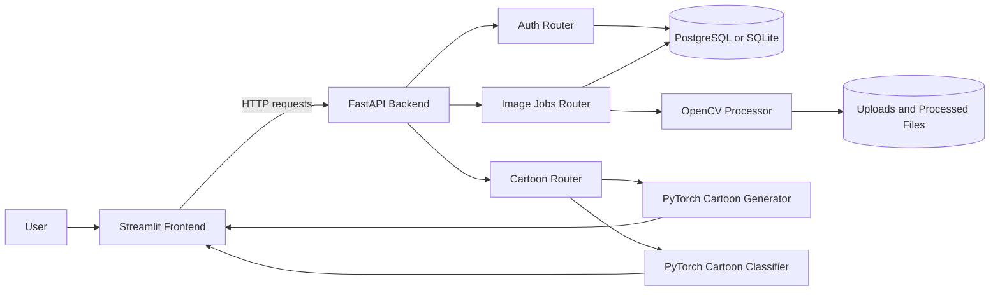

# Neural Canvas AI

### Turn portraits into expressive digital artwork

[](https://neural-canvas-0hab.onrender.com/)
[](https://fastapi.tiangolo.com/)
[](https://streamlit.io/)
[](https://pytorch.org/)
[](https://opencv.org/)
[](https://render.com/)

Neural Canvas is a full-stack AI image transformation application. It combines a Streamlit creative workspace with a FastAPI backend, OpenCV image effects, PyTorch model inference, JWT authentication, PostgreSQL-backed image jobs, and a gallery for revisiting generated results.

The deployed application is available at **[neural-canvas-0hab.onrender.com](https://neural-canvas-0hab.onrender.com/)**.

## Why I Built This

I built Neural Canvas to explore how computer vision and deep learning can become a complete, approachable creative product instead of remaining isolated inside notebooks or model demos.

Image transformation is a natural way to make AI tangible: users can upload a familiar portrait, choose a visual direction, and immediately see how different algorithms interpret the same image. The project brings together that visual experimentation with the engineering challenges behind a real application, including authentication, asynchronous jobs, persistent metadata, file handling, model serving, and deployment.

Neural Canvas is also a practical learning project. It connects classical OpenCV techniques with trained PyTorch models and wraps both inside a full-stack workflow that people can actually use.

## Start Here

<div align="center">

[](https://neural-canvas-0hab.onrender.com/)
[](#run-locally)
[](#how-it-works)

</div>

<details open>
<summary><b>Choose a workflow</b></summary>

| I want to... | Start here |
| --- | --- |
| Try the application | [Open the deployed Neural Canvas app](https://neural-canvas-0hab.onrender.com/) |
| Transform a portrait | [Read the transformation workflow](#how-it-works) |
| Generate a cartoon | [Read about the generator](#ai-models) |
| Classify a cartoon face | [Read about the classifier](#ai-models) |
| Run the project on my machine | [Follow the local setup](#run-locally) |

</details>

---

## Contents

- [What It Does](#what-it-does)
- [Why I Built This](#why-i-built-this)
- [Features](#features)
- [How It Works](#how-it-works)
- [Architecture](#architecture)
- [Transformation Styles](#transformation-styles)
- [AI Models](#ai-models)
- [Project Structure](#project-structure)
- [Run Locally](#run-locally)
- [Future Scope](#future-scope)

## What It Does

Neural Canvas supports three complementary creative workflows:

1. **Transform an image** with one of five classic computer-vision styles.
2. **Generate a cartoon** with a trained PyTorch image-to-image generator.
3. **Classify a cartoon face** against the project's celebrity-identity dataset.

Authenticated users can upload images, create processing jobs, monitor their status, view generated files, download results, and browse their previous transformations.

## Features

| Area | Capability |
| --- | --- |
| Image transformation | Cartoon, pencil sketch, color pencil, edge-preserving, and watercolor effects. |
| AI generation | Direct photo-to-cartoon generation using the trained generator checkpoint. |
| Face classification | Top-k cartoon-face predictions with identity names and confidence percentages. |
| Accounts | Signup, login, JWT access tokens, refresh tokens, logout, and password changes. |
| Image jobs | Upload, process asynchronously, poll status, list history, view files, and download results. |
| Comparisons | Saves a side-by-side original/result comparison image for transformation jobs. |
| Responsive workflow | Streamlit tabs for Transform, Classify, Generate, and Gallery. |
| Deployment | Render blueprint with separate frontend, backend, and PostgreSQL services. |

## How It Works

### 1. Create an account

The Streamlit frontend sends signup and login requests to the FastAPI service. The backend validates the request, hashes passwords with `bcrypt`, stores users in PostgreSQL or SQLite, and returns access and refresh JWTs.

### 2. Upload an image

An authenticated image upload is saved under the configured upload directory and recorded as an `ImageJob`. The selected style and original filename are stored with the job.

### 3. Start processing

The processing endpoint schedules a background task and immediately returns a `processing` job response. The frontend polls the job endpoint until the job is `completed` or `failed`.

### 4. Generate and display results

The backend saves the processed image and a side-by-side comparison image. The frontend retrieves the files as bytes and displays them with Streamlit download controls.

### 5. Use the AI tools

The direct cartoon generator and classifier endpoints load their model singletons only when those features are used. CPU-bound inference runs in worker threads and both models share a process-wide inference lock to prevent overlapping model execution.

## Architecture



The repository is split into two deployable Python services:

- **Frontend:** Streamlit UI in `frontend/`.
- **Backend:** FastAPI API, database layer, image processing, and ML inference in `backend/`.

The backend uses lazy initialization for heavyweight image-processing and ML components. Authentication and health-check startup do not need to load the generator, classifier, OpenCV processor, or their model weights.

## Transformation Styles

The standard transformation workflow uses OpenCV and saves both the processed result and a comparison image.

| Style value | Display name | Implementation |
| --- | --- | --- |
| `cartoon` | Cartoon | Bilateral smoothing, color quantization, adaptive edge extraction, and compositing. |
| `pencil_sketch` | Pencil Sketch | Grayscale conversion, inversion, blur, and color-dodge blending. |
| `color_pencil` | Color Pencil | Stylization, Canny edges, blending, and saturation enhancement. |
| `edge_preserve` | Edge Preserve | Edge-preserving filtering, detail enhancement, and sharpening. |
| `watercolor` | Watercolor | Repeated bilateral filtering, median smoothing, color quantization, and edge blending. |

Input images are resized to a maximum longest dimension of 1200 pixels before OpenCV processing to reduce CPU and memory pressure while preserving aspect ratio.

## AI Models

### Cartoon generator

- Architecture: encoder-decoder style `CartoonGenerator` with four residual blocks.
- Weights: `backend/ml_weights/cartoon_generator.pt`.
- Input preprocessing: RGB conversion, aspect-ratio-preserving resize, dimensions aligned to multiples of four, and normalization to `[-1, 1]`.
- Maximum generator processing dimension: 512 pixels.
- Inference: `torch.inference_mode()` and evaluation mode.

### Cartoon classifier

- Architecture: ResNet18 with a project-specific final classification layer.
- Weights: `backend/ml_weights/cartoon_resnet18.pt`.
- Labels: `backend/ml_weights/cartoon_labels.json`.
- Input preprocessing: resize, center crop to 224 pixels, ImageNet normalization.
- Output: configurable top-k predictions with identity, display name, confidence, and class index.

Both model accessors use singleton instances. Model creation is protected by the shared lock in `backend/app/ml/inference_lock.py`, and model inference is serialized within the process to keep memory use predictable on small Render instances.

## Project Structure

```text
Neural-Canvas/
├── backend/
│   ├── app/
│   │   ├── core/              # Settings and security helpers
│   │   ├── image_processing/  # OpenCV transformations and lazy processor
│   │   ├── ml/                # Generator, classifier, and shared lock
│   │   ├── models/            # SQLAlchemy User and ImageJob models
│   │   ├── routers/           # Auth, image, and cartoon API routes
│   │   ├── schemas/           # Pydantic request/response models
│   │   ├── services/          # Authentication and image-job services
│   │   ├── database.py        # SQLAlchemy engine and session dependency
│   │   └── main.py            # FastAPI application entry point
│   ├── ml_weights/            # Generator, classifier, and label assets
│   ├── notebooks/             # Training and experimentation notebooks
│   └── requirements.txt
├── frontend/
│   ├── app.py                 # Streamlit entry point
│   ├── views.py               # Auth, transform, classify, generate, gallery UI
│   ├── utils.py               # API client and session helpers
│   ├── styles.py              # Streamlit styling helpers
│   └── requirements.txt
├── storage/
│   ├── uploads/               # Local original uploads
│   └── processed/             # Local generated files
├── render.yaml                # Render frontend/backend/database blueprint
├── requirements.txt           # Combined/root dependency list
└── README.md
```

## Run Locally

### Prerequisites

- Python 3.12 recommended, matching the Render blueprint.
- A virtual environment.
- PostgreSQL for production-like local testing, or SQLite for a lightweight local setup.
- Enough disk space for the PyTorch and torchvision packages plus model weights.

### Start the backend

```bash
git clone https://github.com/yuvrajrgv/Neural-Canvas.git
cd Neural-Canvas/backend

python -m venv .venv
source .venv/bin/activate
pip install -r requirements.txt

# Optional local environment overrides
export DATABASE_URL="sqlite:///./neuralcanvas.db"
export SECRET_KEY="replace-this-for-local-development"

uvicorn app.main:app --reload --host 0.0.0.0 --port 8000
```

Backend endpoints and documentation will be available at `http://localhost:8000`.

### Start the frontend

Open another terminal:

```bash
cd Neural-Canvas/frontend

python -m venv .venv
source .venv/bin/activate
pip install -r requirements.txt

export API_BASE_URL="http://localhost:8000"
streamlit run app.py --server.address 0.0.0.0 --server.port 8501
```

The Streamlit interface will be available at `http://localhost:8501`.

## Author

Built by [yuvrajrgv](https://github.com/yuvrajrgv).

## Future Scope

Neural Canvas can grow into a richer creative studio through several focused additions:

- Add durable object storage so user galleries survive service restarts and ephemeral deployments.
- Introduce more artistic models, including anime, comic-book, watercolor, and sketch-specific generators.
- Add side-by-side editing controls for intensity, color, edge strength, and output resolution.
- Support batch processing and downloadable collections for multiple images.
- Add richer gallery features such as search, filters, favorites, sharing, and image metadata.
- Move long-running jobs to a dedicated queue and worker system for more reliable scaling.
- Add model versioning and experiment tracking so generated results can be reproduced.
- Expand the classifier with more identities and clearer confidence visualizations.
- Add automated API, authentication, image-processing, and model smoke tests.
- Provide optional GPU-backed deployment for faster generation and classification.
