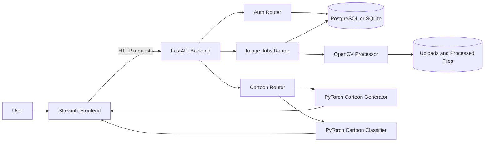

# Neural Canvas AI

### Turn portraits into expressive digital artwork

[](https://neural-canvas-0hab.onrender.com/)
[](https://fastapi.tiangolo.com/)
[](https://streamlit.io/)
[](https://pytorch.org/)
[](https://opencv.org/)
[](https://render.com/)

Neural Canvas is a full-stack AI image transformation application. It combines a Streamlit creative workspace with a FastAPI backend, OpenCV image effects, PyTorch model inference, JWT authentication, PostgreSQL-backed image jobs, and a gallery for revisiting generated results.

The deployed application is available at **[neural-canvas-0hab.onrender.com](https://neural-canvas-0hab.onrender.com/)**.

---

## Contents

- [What It Does](#what-it-does)
- [Features](#features)
- [How It Works](#how-it-works)
- [Architecture](#architecture)
- [Transformation Styles](#transformation-styles)
- [AI Models](#ai-models)
- [Authentication and Data](#authentication-and-data)
- [API Overview](#api-overview)
- [Project Structure](#project-structure)
- [Run Locally](#run-locally)
- [Deploy with Render](#deploy-with-render)
- [Memory and Performance](#memory-and-performance)
- [Limitations and Future Work](#limitations-and-future-work)
- [License](#license)

## What It Does

Neural Canvas supports three complementary creative workflows:

1. **Transform an image** with one of five classic computer-vision styles.
2. **Generate a cartoon** with a trained PyTorch image-to-image generator.
3. **Classify a cartoon face** against the project's celebrity-identity dataset.

Authenticated users can upload images, create processing jobs, monitor their status, view generated files, download results, and browse their previous transformations.

## Features

| Area | Capability |
| --- | --- |
| Image transformation | Cartoon, pencil sketch, color pencil, edge-preserving, and watercolor effects. |
| AI generation | Direct photo-to-cartoon generation using the trained generator checkpoint. |
| Face classification | Top-k cartoon-face predictions with identity names and confidence percentages. |
| Accounts | Signup, login, JWT access tokens, refresh tokens, logout, and password changes. |
| Image jobs | Upload, process asynchronously, poll status, list history, view files, and download results. |
| Comparisons | Saves a side-by-side original/result comparison image for transformation jobs. |
| Responsive workflow | Streamlit tabs for Transform, Classify, Generate, and Gallery. |
| Deployment | Render blueprint with separate frontend, backend, and PostgreSQL services. |

## How It Works

### 1. Create an account

The Streamlit frontend sends signup and login requests to the FastAPI service. The backend validates the request, hashes passwords with `bcrypt`, stores users in PostgreSQL or SQLite, and returns access and refresh JWTs.

### 2. Upload an image

An authenticated image upload is saved under the configured upload directory and recorded as an `ImageJob`. The selected style and original filename are stored with the job.

### 3. Start processing

The processing endpoint schedules a background task and immediately returns a `processing` job response. The frontend polls the job endpoint until the job is `completed` or `failed`.

### 4. Generate and display results

The backend saves the processed image and a side-by-side comparison image. The frontend retrieves the files as bytes and displays them with Streamlit download controls.

### 5. Use the AI tools

The direct cartoon generator and classifier endpoints load their model singletons only when those features are used. CPU-bound inference runs in worker threads and both models share a process-wide inference lock to prevent overlapping model execution.

## Architecture



The repository is split into two deployable Python services:

- **Frontend:** Streamlit UI in `frontend/`.
- **Backend:** FastAPI API, database layer, image processing, and ML inference in `backend/`.

The backend uses lazy initialization for heavyweight image-processing and ML components. Authentication and health-check startup do not need to load the generator, classifier, OpenCV processor, or their model weights.

## Transformation Styles

The standard transformation workflow uses OpenCV and saves both the processed result and a comparison image.

| Style value | Display name | Implementation |
| --- | --- | --- |
| `cartoon` | Cartoon | Bilateral smoothing, color quantization, adaptive edge extraction, and compositing. |
| `pencil_sketch` | Pencil Sketch | Grayscale conversion, inversion, blur, and color-dodge blending. |
| `color_pencil` | Color Pencil | Stylization, Canny edges, blending, and saturation enhancement. |
| `edge_preserve` | Edge Preserve | Edge-preserving filtering, detail enhancement, and sharpening. |
| `watercolor` | Watercolor | Repeated bilateral filtering, median smoothing, color quantization, and edge blending. |

Input images are resized to a maximum longest dimension of 1200 pixels before OpenCV processing to reduce CPU and memory pressure while preserving aspect ratio.

## AI Models

### Cartoon generator

- Architecture: encoder-decoder style `CartoonGenerator` with four residual blocks.
- Weights: `backend/ml_weights/cartoon_generator.pt`.
- Input preprocessing: RGB conversion, aspect-ratio-preserving resize, dimensions aligned to multiples of four, and normalization to `[-1, 1]`.
- Maximum generator processing dimension: 512 pixels.
- Inference: `torch.inference_mode()` and evaluation mode.

### Cartoon classifier

- Architecture: ResNet18 with a project-specific final classification layer.
- Weights: `backend/ml_weights/cartoon_resnet18.pt`.
- Labels: `backend/ml_weights/cartoon_labels.json`.
- Input preprocessing: resize, center crop to 224 pixels, ImageNet normalization.
- Output: configurable top-k predictions with identity, display name, confidence, and class index.

Both model accessors use singleton instances. Model creation is protected by the shared lock in `backend/app/ml/inference_lock.py`, and model inference is serialized within the process to keep memory use predictable on small Render instances.

## Authentication and Data

### Authentication

- Passwords are hashed with `bcrypt`; plaintext passwords are never stored.
- Access tokens expire according to `ACCESS_TOKEN_EXPIRE_MINUTES`.
- Refresh tokens expire according to `REFRESH_TOKEN_EXPIRE_DAYS`.
- Protected image routes use bearer-token authentication.
- Duplicate email or username registration returns a client error instead of creating a second account.
- Database failures during authentication return a generic temporary-unavailable response without exposing SQL, credentials, or stack traces to clients.

### Database models

The application currently stores:

- `users`: account identity, password hash, activation state, and timestamps.
- `image_jobs`: uploaded filename/path, selected style, processing status, generated paths, error state, download count, and timestamps.

### Storage

The configured directories are:

- `UPLOAD_DIR`: original uploaded files.
- `PROCESSED_DIR`: generated and comparison files.

The Render blueprint points both directories to `/tmp/neural-canvas`. Render filesystem storage is ephemeral, so persistent image history requires a persistent disk or object storage integration.

## API Overview

FastAPI exposes interactive documentation at `/docs` and `/redoc` on the backend service.

### System

| Method | Endpoint | Purpose |
| --- | --- | --- |
| `GET` | `/` | API metadata and running status. |
| `GET` | `/health` | Lightweight health check used by Render. |

### Authentication

| Method | Endpoint | Purpose |
| --- | --- | --- |
| `POST` | `/auth/signup` | Create an account and return JWT tokens. |
| `POST` | `/auth/login` | Authenticate with username or email. |
| `POST` | `/auth/login/form` | OAuth2-compatible form login for Swagger. |
| `POST` | `/auth/refresh` | Exchange a refresh token for new tokens. |
| `GET` | `/auth/me` | Return the current authenticated user. |
| `POST` | `/auth/change-password` | Change the current user's password. |

### Image jobs

| Method | Endpoint | Purpose |
| --- | --- | --- |
| `GET` | `/images/styles` | List available transformation styles. |
| `POST` | `/images/upload` | Upload an image and create a job. |
| `POST` | `/images/{job_id}/process` | Start background processing. |
| `GET` | `/images/{job_id}` | Get job status and result URLs. |
| `GET` | `/images/` | List the current user's jobs. |
| `GET` | `/images/file/{job_id}/{file_type}` | Retrieve original, processed, or comparison files. |
| `GET` | `/images/download/{job_id}` | Download a completed processed file. |

### Cartoon AI tools

| Method | Endpoint | Purpose |
| --- | --- | --- |
| `GET` | `/cartoon/info` | Classifier metadata and identities. |
| `POST` | `/cartoon/classify` | Classify an uploaded cartoon face. |
| `GET` | `/cartoon/identities` | List all classifier identities. |
| `GET` | `/cartoon/health` | Classifier model status. |
| `POST` | `/cartoon/generate` | Generate a cartoon PNG from an uploaded photo. |
| `GET` | `/cartoon/generator/info` | Generator model metadata. |

## Project Structure

```text
Neural-Canvas/
├── backend/
│   ├── app/
│   │   ├── core/              # Settings and security helpers
│   │   ├── image_processing/  # OpenCV transformations and lazy processor
│   │   ├── ml/                # Generator, classifier, and shared lock
│   │   ├── models/            # SQLAlchemy User and ImageJob models
│   │   ├── routers/           # Auth, image, and cartoon API routes
│   │   ├── schemas/           # Pydantic request/response models
│   │   ├── services/          # Authentication and image-job services
│   │   ├── database.py        # SQLAlchemy engine and session dependency
│   │   └── main.py            # FastAPI application entry point
│   ├── ml_weights/            # Generator, classifier, and label assets
│   ├── notebooks/             # Training and experimentation notebooks
│   └── requirements.txt
├── frontend/
│   ├── app.py                 # Streamlit entry point
│   ├── views.py               # Auth, transform, classify, generate, gallery UI
│   ├── utils.py               # API client and session helpers
│   ├── styles.py              # Streamlit styling helpers
│   └── requirements.txt
├── storage/
│   ├── uploads/               # Local original uploads
│   └── processed/             # Local generated files
├── render.yaml                # Render frontend/backend/database blueprint
├── requirements.txt           # Combined/root dependency list
└── README.md
```

## Run Locally

### Prerequisites

- Python 3.12 recommended, matching the Render blueprint.
- A virtual environment.
- PostgreSQL for production-like local testing, or SQLite for a lightweight local setup.
- Enough disk space for the PyTorch and torchvision packages plus model weights.

### Start the backend

```bash
git clone https://github.com/yuvrajrgv/Neural-Canvas.git
cd Neural-Canvas/backend

python -m venv .venv
source .venv/bin/activate
pip install -r requirements.txt

# Optional local environment overrides
export DATABASE_URL="sqlite:///./neuralcanvas.db"
export SECRET_KEY="replace-this-for-local-development"

uvicorn app.main:app --reload --host 0.0.0.0 --port 8000
```

Backend endpoints and documentation will be available at `http://localhost:8000`.

### Start the frontend

Open another terminal:

```bash
cd Neural-Canvas/frontend

python -m venv .venv
source .venv/bin/activate
pip install -r requirements.txt

export API_BASE_URL="http://localhost:8000"
streamlit run app.py --server.address 0.0.0.0 --server.port 8501
```

The Streamlit interface will be available at `http://localhost:8501`.

### Configuration

Important backend settings are read from environment variables:

| Variable | Purpose | Default |
| --- | --- | --- |
| `DATABASE_URL` | SQLAlchemy database connection string. | `sqlite:///./neuralcanvas.db` |
| `SECRET_KEY` | JWT signing secret. | Development-only fallback; set this in deployment. |
| `DEBUG` | Application debug flag. | `false` |
| `UPLOAD_DIR` | Original upload directory. | `storage/uploads` |
| `PROCESSED_DIR` | Generated file directory. | `storage/processed` |
| `ACCESS_TOKEN_EXPIRE_MINUTES` | Access-token lifetime. | `30` |
| `REFRESH_TOKEN_EXPIRE_DAYS` | Refresh-token lifetime. | `7` |

The frontend reads `API_BASE_URL`. It accepts either a complete URL such as `https://api.example.com` or a hostname and normalizes it to HTTPS.

## Deploy with Render

The repository includes `render.yaml` for a three-part deployment:

1. `neural-canvas-api`: FastAPI service rooted at `backend/`.
2. `neural-canvas-frontend`: Streamlit service rooted at `frontend/`.
3. `neural-canvas-db`: PostgreSQL database connected to the backend.

The backend starts with:

```bash
uvicorn app.main:app --host 0.0.0.0 --port $PORT
```

The frontend starts with:

```bash
streamlit run app.py --server.address 0.0.0.0 --server.port $PORT
```

The blueprint injects the database connection string, generates `SECRET_KEY`, configures `/health` as the backend health check, and passes the backend hostname to the frontend through `API_BASE_URL`.

The deployed frontend is available at:

**[https://neural-canvas-0hab.onrender.com/](https://neural-canvas-0hab.onrender.com/)**

For production use, configure persistent storage for uploaded and processed images. The current `/tmp` paths are suitable for ephemeral processing but should not be treated as durable user storage.

## Memory and Performance

The application is designed for small-memory deployment environments:

- The generator preprocesses images at a maximum dimension of 512 pixels.
- OpenCV processing is capped at 1200 pixels on the longest side.
- Model inference uses `torch.inference_mode()` and evaluation mode.
- Generator and classifier inference share one process-wide lock.
- CPU-bound model calls run in worker threads instead of blocking the async event loop.
- Model and processor singletons prevent duplicate instances within a worker.
- Processor, generator, and classifier imports are deferred until their features are used.
- Temporary PIL images, tensors, buffers, and OpenCV arrays are released after processing.

The generator and classifier are still large PyTorch workloads. A Render instance with a 512 MB limit should be monitored during real inference, and the backend should run with a single worker unless memory is measured carefully with multiple workers.

## Limitations and Future Work

- Render `/tmp` storage is ephemeral; durable image storage is not yet integrated.
- Model inference is CPU-bound on deployments without a GPU and may take time for larger inputs.
- The standard image transformation flow uses background tasks backed by the API process rather than a separate job queue.
- There is no automated test suite in the repository yet.
- The generator and classifier checkpoints are bundled in the repository, which increases deployment size.
- A production deployment would benefit from object storage, structured migrations, rate limiting, and external job processing.

## License

No separate license file is currently included in the repository. Add a license before distributing Neural Canvas as an open-source project.

## Author

Built by [yuvrajrgv](https://github.com/yuvrajrgv).
